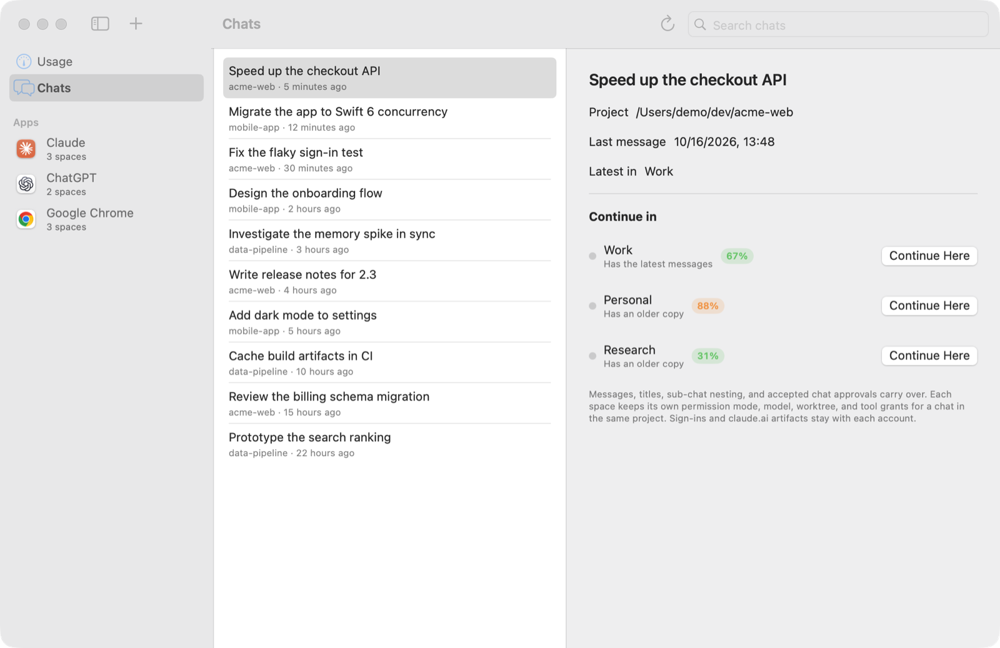
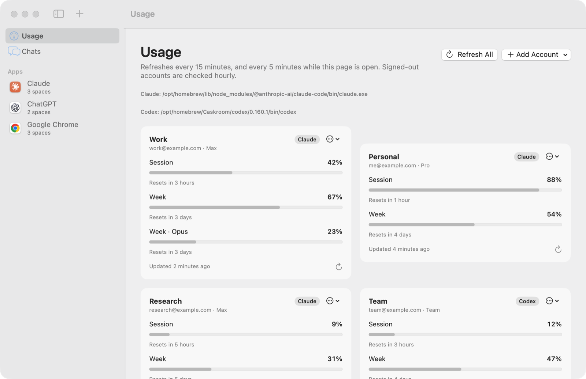
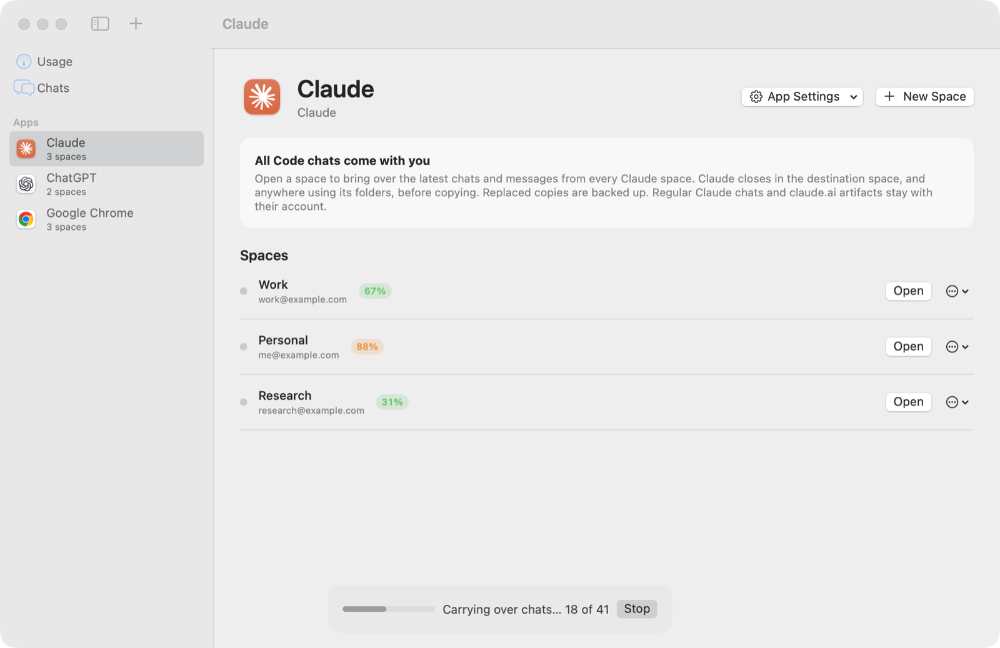

# Parallax

One Mac, several Claude and Codex accounts. Parallax shows how much of each account's limits you've used, opens a separate copy of an app for every account, and keeps your chats with you when you switch accounts.

<picture>
  <source media="(prefers-color-scheme: dark)" srcset="docs/images/chats-dark.png">
  
</picture>

## What it does

### Usage at a glance

<picture>
  <source media="(prefers-color-scheme: dark)" srcset="docs/images/usage-dark.png">
  
</picture>

- Session and weekly limits for every Claude and Codex account, side by side.
- Each account has its own private command-line login, separate from your app spaces.
- Refreshes every 15 minutes, and every 5 minutes while the Usage page is open. Signed-out accounts are re-checked hourly, and an account is only marked signed out after the answer is confirmed.
- Uses the newest `claude` and `codex` command-line tools it can find, and shows which one.

### A space for every account

<picture>
  <source media="(prefers-color-scheme: dark)" srcset="docs/images/spaces-dark.png">
  
</picture>

A space is a separate copy of an app with its own sign-in and data. Open as many as you like at the same time.

| App | How each space is kept separate |
|---|---|
| Claude | `--user-data-dir` and `CLAUDE_CONFIG_DIR` |
| Codex (the ChatGPT app) | `--user-data-dir`, `CODEX_HOME` and `CODEX_ELECTRON_USER_DATA_PATH` |
| Chrome-family browsers and Electron apps | `--user-data-dir` |
| VS Code-family editors | `--user-data-dir` and `--extensions-dir` |
| Firefox | `-profile` and `-no-remote` |
| Anything else | Not isolated; opens the app as usual |

- A running space shows a green dot with **Show** and **Quit**. Parallax never starts the same space twice.
- **Edit Space** adds launch arguments or environment variables (`KEY=VALUE`, or `unset KEY`). Folder settings are checked before launch.
- Codex works differently by default; see below.

### Your chats come with you

**Claude.** Opening a Claude space brings in the Claude Code chats and new messages from your other Claude spaces, so you can pick up where you left off in another account.

- **Carried over:** messages, titles, sub-chats nested under their parent chat, forked chats, subagent conversations, and chat approvals you already accepted.
- **Kept per account:** sign-ins, regular claude.ai chats and artifacts, account policies, workspace trust, and tool grants. For a chat in the same project, each space keeps its own permission mode, model and worktree.
- **Continue a specific chat:** pick it on the Chats page and choose **Continue Here** next to the space you want.

**Codex.** Codex can switch accounts inside the app, so Parallax keeps one chat history for all Codex accounts. This is on by default for a newly added Codex app. Codex opens with all your chats in `~/.codex`; when an account runs out, switch accounts inside Codex and keep going in the same chat. Turn **One chat history for all Codex accounts** off on the Codex app page to give each account its own Codex window instead; chats then stay with the account that started them.

### Fast, careful carry-over

<picture>
  <source media="(prefers-color-scheme: dark)" srcset="docs/images/sync-dark.png">
  
</picture>

- When you open a Claude space, Parallax first checks the other spaces using file details only, which is safe while Claude runs.
  - Nothing new: the space opens, or comes to the front, right away.
  - New messages elsewhere: Parallax copies only the chats that changed, then opens the space.
  - The space is already open: Parallax asks before closing it to update.
- Only Claude in the space you open, and any Claude using that space's folders, is closed. Your other accounts keep running.
- Copying shows progress and can be stopped. It stops between chats, so a chat is never left half-copied.
- Anything that would be replaced is backed up first. Parallax never deletes a chat.
- A chat continued separately in two accounts is reported and left alone. **Continue Here** replaces it with the most recent copy after saving a backup.
- After you install a new version of Parallax, the first open of each Claude space checks every chat once. That can take a minute with a very large history; after that, opens take about a second.

## Install

You need macOS 14 or later and Xcode 16 or later (Swift 6) to build. Usage tracking needs the `claude` and/or `codex` command-line tools, installed with Homebrew, npm, or the native installer.

```bash
git clone https://github.com/38st/Parallax.git
cd Parallax
./script/build_app.sh --install
```

`./script/build_app.sh` alone builds `dist/Parallax.app` without installing it. Quit Parallax before installing a new version.

### First steps

1. Click **+** in the sidebar and choose an app, for example Claude or ChatGPT.
2. Click **New Space** for each account, open it, and sign in inside the app.
3. For Claude, open the Code tab once in each new space, then open the space again through Parallax to bring in your chats.
4. On the Usage page, click **Add Account** and sign in to each account you want to track.

## Where Parallax keeps things

Everything lives in `~/Library/Application Support/Parallax/`:

| Item | What it is |
|---|---|
| `state.json` | Your apps, spaces and usage accounts |
| `state.backup.json` | A copy of `state.json` from before the last removal |
| `Profiles/` | Each space's data folder, including its sign-in |
| `AccountSessions/` | Private command-line logins used only to read usage |
| `ChatBackups/` | Chat files saved before Parallax replaced them |
| `ChatSyncCache.json` | Which chats are already up to date; safe to delete |

## Troubleshooting

- **"This account's command-line login has ended."** The provider's login expired. Click **Sign In** on that account.
- **"Claude is also open without a space."** Claude reopened on its own, usually after updating itself or after a restart, so it shows Claude's default account. Quit it and open your space from Parallax.
- **"Claude is still open in …"** Claude asked you to confirm quitting, or is waiting for its running Code sessions to finish. Answer it in Claude, then open the space again.
- **"This chat was continued separately in another account."** Use **Continue Here** on the Chats page to choose which copy to keep. The other copy is backed up.
- **"Open Claude Code once in …"** That space hasn't been signed in to, or its Code tab hasn't been opened yet.
- **"… needs an absolute folder path."** Fix the space's folder settings in **Edit Space**.
- **"state.json was changed by another copy of Parallax."** Quit the other copy and reopen Parallax.

## Good to know

- Only Claude **Code** chats can move between accounts. Regular Claude chats live on Anthropic's servers under each account.
- Parallax doesn't copy Codex chats between separate Codex windows. Codex keeps its chat list in its own databases, so the shared history is the reliable way to keep Codex chats together.
- Deleted, archived, SSH and WSL chats, and routine runs, aren't carried over automatically.
- Carry-over reads Claude Desktop's own chat files, and usage reads the providers' command-line output. Neither format is a public API, so an update to Claude or a CLI can stop them working until Parallax is updated. When that happens, Parallax reports it and leaves your files alone.
- Spaces are separate data folders, not a security boundary between accounts. Copying a chat into another account copies its content, so keep work and personal accounts apart if your organization requires it, and use your accounts as the providers' terms allow.
- A locally built app is signed ad hoc. To share it with others, sign it with a Developer ID and notarize it.

## Development

```bash
swift build -c release
swift test
```

- Set `PARALLAX_SUPPORT_DIR=/some/scratch/folder` to make a development run use that folder instead of your real data.
- Tests use temporary folders and synthetic data only; they never touch your real Parallax data, `~/.claude`, `~/.codex`, or the Keychain.
- Code layout: `Sources/Parallax/Chats` (chat carry-over), `Launch` (spaces), `Providers` (usage), `Model` (state), `Views` (SwiftUI).
- See [AGENTS.md](AGENTS.md) for the project's conventions and [CONTRIBUTING.md](CONTRIBUTING.md) for how to contribute.

## Upgrading from Parallax 1.x

On first launch, Parallax 2 reads the 1.x library, usage accounts and Codex history setting, and keeps using the same space folders, so sign-ins and chats carry over. It never changes the 1.x files. The 1.x source is in the git history up to commit `569ed34`.

## License

[MIT](LICENSE)
